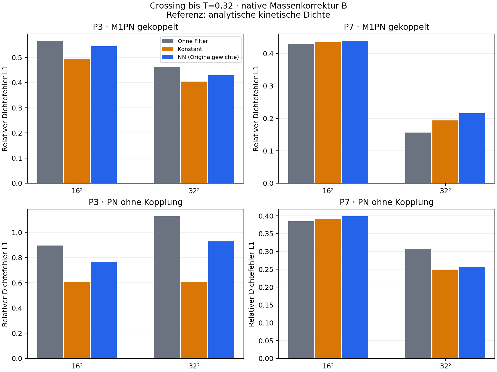
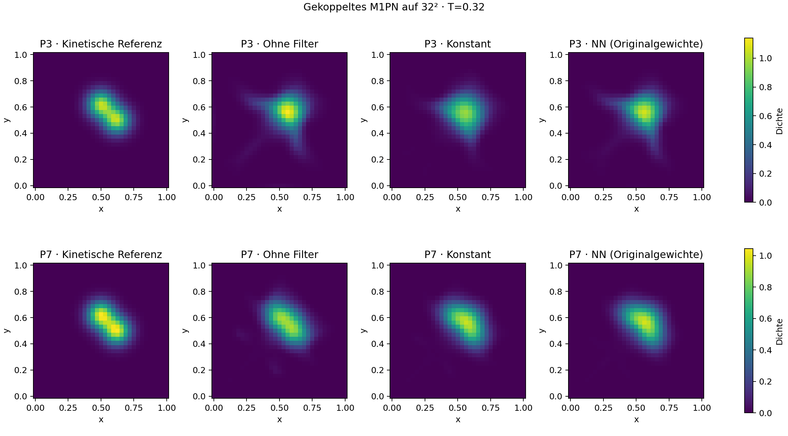

# NN-FPN im M1PN-Massenkorrektur-Solver: lokaler Test vom 09.11.2026

**27 von 27 Läufen abgeschlossen und aus gespeicherten Feldern geprüft.** Das NN senkt den relativen L1-Dichtefehler gegenüber ungefiltertem B in 5/8 Vergleichen. Gegenüber der konstanten Paperstärke gewinnt es in 0/8 Vergleichen.

Die Originalgewichte wurden ohne neues Training auf den nativen FE/M1PN-Pfad übertragen. Die Ergebnisse gelten für diesen Crossing-Test und diese groben Gitter. Ein allgemeiner Vorteil gegenüber konstanter Filterung ist daraus nicht belegt.

## Relativer L1-Dichtefehler zur kinetischen Referenz

| Gitter | PN | Kopplung | Ohne Filter | Konstant | NN | NN / ohne |
|---|---|---|---:|---:|---:|---:|
| 16² | P3 | m1pn | 0.565396 | 0.495679 | 0.544236 | 0.9626 |
| 16² | P3 | pn-only | 0.896072 | 0.609880 | 0.764452 | 0.8531 |
| 16² | P7 | m1pn | 0.430066 | 0.434726 | 0.438509 | 1.0196 |
| 16² | P7 | pn-only | 0.384640 | 0.391695 | 0.398584 | 1.0363 |
| 32² | P3 | m1pn | 0.462150 | 0.403651 | 0.429918 | 0.9303 |
| 32² | P3 | pn-only | 1.127190 | 0.606387 | 0.928073 | 0.8234 |
| 32² | P7 | m1pn | 0.156195 | 0.193285 | 0.215946 | 1.3825 |
| 32² | P7 | pn-only | 0.306210 | 0.247147 | 0.256607 | 0.8380 |

Kleinere Werte sind besser. Der Nenner ist jeweils die massengewichtete L1-Norm der analytischen kinetischen Dichte bei T=0.32. Der Fehler enthält den endlichen PN-Modellfehler. Es wurden keine negativen Dichten vor der Fehlerauswertung abgeschnitten.





## Erhaltung und Stabilität

* Größter unabhängig nachgerechneter globaler Bilanzrest aller PN-Komponenten: `1.932e-15`. Rand-, Material- und Filterbeiträge sind enthalten.
* Der Dichtebeitrag des Filters ist in sämtlichen gespeicherten Filterbilanzen exakt null.
* Rückgewiesene Schrittversuche über alle Läufe: 0.
* Gekoppelte Läufe: kleinste Enddichte `0.00010865`, kleinster Kegelabstand `9.31022e-06`.
* Ungekuppeltes PN besitzt auch mit Filter negative Dichten und Kegelverletzungen; der Filter ersetzt den M1-Limiter nicht. Details stehen in `results.csv`.

## Halbierte Schrittweite bei gekoppeltem P3/32²

| Filter | Basisfehler | Fehler bei dt/2 | Feldänderung L1 / Referenznorm | Änderung / Basisfehler |
|---|---:|---:|---:|---:|
| off | 0.4621498 | 0.4621496 | 5.714e-07 | 1.236e-06 |
| constant | 0.4036511 | 0.4036510 | 1.317e-06 | 3.262e-06 |
| nn | 0.4299184 | 0.4299174 | 4.228e-06 | 9.833e-06 |

Die Feldänderung ist ein Vergleich zweier Zeitschrittweiten, keine Schätzung der räumlichen Konvergenzordnung oder des exakten Zeitfehlers.

## Umsetzung und Validierung

* 19 algebraische Prüfungen: Filterkoeffizienten, analytische Dämpfung, Dichteerhaltung, Dissipation, Kegel, Rotationskommutation, Netzwerte und Eingabeschutz.
* C++-Netz gegen PyTorch für P3/P5/P7/P9 bei float64 und identischen Gewichten: maximaler absoluter Fehler `7.11e-15`.
* Merkmalsaufbereitung gegen die beiden Originalfunktionen im Autoren-Code: maximaler Fehler `1.55e-15` bei identischen vorgegebenen FE-Ableitungsfeldern.
* Ende-zu-Ende: Filter aus und konstante Stärke null liefern bitgleiche Felder zum separat gebauten unveränderten Studienprogramm; außerdem Tests beider Kopplungen und von Absorption, Streuung und Quelle.
* Jeder Methodenvergleich prüft identische Anfangsfelder, Knotenmassen und akzeptierte Zeitschritte. Alle gespeicherten Zustände sind endlich.

## Grenzen und Reproduktion

Kein Retraining auf FE, M1PN oder Crossing. Die tatsächlich veröffentlichte Merkmalsdefinition einschließlich räumlicher Standardisierung wird übernommen; sie entspricht nicht exakt den abstrakten Merkmalen des PDFs. Der Filter wird über exponentielle Mittelpunktsschritte um den SSPRK3-Transport integriert. Einzelheiten und die Abweichungen zum Autoren-Code stehen in [README.md](../../README.md).

Die Laufzeiten in `results.csv` stammen aus einzelnen lokalen Läufen und schließen unterschiedliche Initialisierungs-/Dateikosten ein. Sie sind keine belastbare Performancestudie. `filter_seconds` erfasst separat die Filterschritte.

Die Rohfelder liegen unter `../../tmp/crossing_20261109/`, einschließlich `filter_verification.json` je Lauf. `manifest.json` sichert Binary, Protokoll, Elternstand, Modellmanifest und Ergebnisdatei. Die Vergleichswerte stehen in [results.csv](results.csv), [results.json](results.json) und [comparison.json](comparison.json). PDF-Ausgaben: [Fehler](errors.pdf), [Dichte](density_32.pdf), [Stärke](strength_32.pdf).

```bash
python3 scripts/study.py --output results/neuer_vergleich
python3 scripts/analyze.py --study results/neuer_vergleich
```
